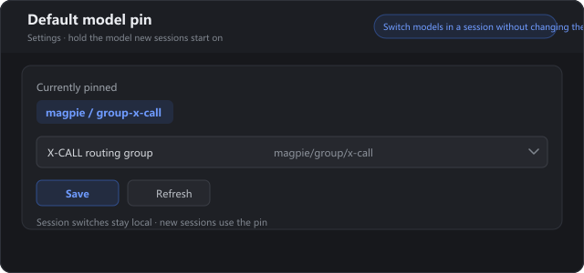

# dsh-pin-default-model

English | [简体中文](./README.zh.md)

Pins the DeepSeek Harness default model **and reasoning effort**, so switching either inside a session never changes what the next new session starts with. Change the pin any time from **Settings → Default model pin**.



## The problem

DSH records a model change made inside a session as the new process-wide default. In `sessionController.selectModel()` the choice is applied to the session, and then `agentDefaultModel.saveSelection()` rewrites the profile patch with the same selection.

The visible effect: every new conversation — hand-made or created by a scheduled task — silently inherits whatever model you picked last, instead of the default you configured. There is no setting that turns this off.

## What this plugin does

It replaces `saveSelection` on the live `agentDefaultModel` service with one that refuses to move the default away from the pin:

| Action | Result |
| --- | --- |
| Switch models inside a session | ✅ works, that session uses the new model |
| Switch reasoning effort inside a session | ✅ works, that session uses the new effort |
| New session afterwards | ✅ still starts on the pinned model and effort |
| Change the pin in Settings | ✅ applies to all later new sessions |
| Unload the plugin | ✅ original behaviour returns |

The pin is a routing triple: provider, model, and an optional reasoning effort. The browser page talks to two local host routes with plain fetch; it has no dependency on DSH's settings-client services, so it loads regardless of plugin activation order.

## Reasoning effort

The effort dropdown lists the levels the **selected model** actually offers, taken from the live model catalog.

- **Follow the model default** leaves the effort unlocked. A session may then use any effort the model offers, and the pin keeps holding only the route.
- **Locking an effort** (for example `high`) pins the route *and* the effort. A session that changes only its effort no longer rewrites the default.

> **A locked effort must be one the model supports.** DSH rejects a call whose effort the model does not offer (`UNSUPPORTED_REASONING_EFFORT`), and some models offer no reasoning effort at all. The plugin refuses to store such a pin and the settings page shows a warning instead of failing later at session creation.

## Configuration

Open **Settings → Default model pin** and pick a model from the grouped dropdown, then pick a reasoning effort and press **Save**. The pin is written to the profile and survives a restart.

It can also be set by hand in `cordis.patch.yml`:

```yaml
- insert:
    - id: dsh-pin-default-model
      name: 'dsh-pin-default-model'
      config:
        provider: magpie
        model: group/x-call
        reasoningEffort: high
```

| Field | Required | Meaning |
| --- | --- | --- |
| `provider` | yes | Provider route to hold, e.g. `magpie`, `workbuddy-ai` |
| `model` | yes | Model id on that route, e.g. `group/x-call` |
| `reasoningEffort` | no | Reasoning effort to hold. Omit it to let the provider default apply |

With no pin configured, the bundled default `magpie / group/x-call` applies.

A change affects sessions created **after** it is saved. An open conversation keeps the model and effort recorded in its own request log.

## Safety and caveats

- All operations are local. No telemetry, no uploads, no network calls.
- Every destructive-looking action is avoided: the original session model switch is untouched.
- **This plugin replaces an internal service method** (`agentDefaultModel.saveSelection`). A future DSH update that renames or restructures that method may make the pin ineffective. The change is installed on the live service instance and fully reverted when the plugin unloads.

## Install

From the DSH app: **Settings → Plugins → Install**, then search `dsh-pin-default-model`.

Or from a terminal:

```bash
dsh plugin --profile web add dsh-pin-default-model
```

Published on [npm](https://www.npmjs.com/package/dsh-pin-default-model).

## Requirements

- DeepSeek Harness `>= 0.2.1`
- Node.js ≥ 22
- Zero runtime dependencies

## Development

```bash
node --check lib/index.js
node --check client/client.js
node test/behaviour.mjs
node test/client.mjs
node test/render.mjs
```

## License

MIT. See [LICENSE](./LICENSE).
