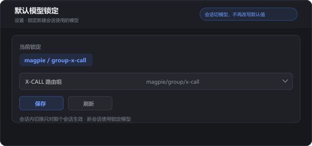

# dsh-pin-default-model

[English](./README.md) | 简体中文

锁定 DeepSeek Harness 的默认模型，让「会话内切换模型」不再影响下一个新会话。随时可在 **设置 → 默认模型锁定** 修改锁定值。



## 它解决什么问题

DSH 会把「在会话里切换模型」记录成新的进程级默认值。`sessionController.selectModel()` 里，选择先应用到当前会话，紧接着 `agentDefaultModel.saveSelection()` 用同一个选择改写 profile 补丁。

实际表现：每个新对话——手动建的、自动化任务建的——都悄悄继承您最后一次选的模型，而不是您配置的默认值。设置里没有开关能关掉这个行为。

## 这个插件做什么

它把 `agentDefaultModel` 服务实例上的 `saveSelection` 换成拒绝改写默认值的版本：

| 操作 | 结果 |
| --- | --- |
| 会话内切换模型 | ✅ 正常生效，该会话用新模型 |
| 之后新建的会话 | ✅ 仍然使用锁定的模型 |
| 在设置里改锁定值 | ✅ 之后新建的会话全部用新值 |
| 卸载插件 | ✅ 恢复 DSH 原有行为 |

浏览器页面通过两条本地路由用纯 fetch 读写，不依赖 DSH 的设置客户端服务，因此不受插件加载顺序影响。

## 配置

打开 **设置 → 默认模型锁定**，在下拉框里选模型，点 **保存**。锁定值写入 profile，重启后依然有效。

也可以手改 `cordis.patch.yml`：

```yaml
- insert:
    - id: dsh-pin-default-model
      name: 'dsh-pin-default-model'
      config:
        provider: magpie
        model: group/x-call
```

| 字段 | 必填 | 含义 |
| --- | --- | --- |
| `provider` | 是 | 要锁定的提供方路由，如 `magpie`、`workbuddy-ai` |
| `model` | 是 | 该路由下的模型 id，如 `group/x-call` |
| `reasoningEffort` | 否 | 一并锁定的推理档位 |

没有配置锁定值时，使用内置的 `magpie / group/x-call`。

改动只对**保存之后**新建的会话生效；已经打开的对话继续使用它请求日志里记录的模型。

## 安全性与注意

- 全部操作在本机完成，无遥测、无上传、无网络请求。
- 不改动会话内正常的模型切换。
- **本插件替换了一个内部服务方法**（`agentDefaultModel.saveSelection`）。若未来 DSH 升级改名或调整该方法结构，锁定可能失效。替换发生在服务实例上，卸载插件时会完全还原。

## 安装

在 DSH 应用里打开 **设置 → 插件 → 安装**，搜索 `dsh-pin-default-model`。

或在终端执行：

```bash
dsh plugin --profile web add dsh-pin-default-model
```

已发布到 [npm](https://www.npmjs.com/package/dsh-pin-default-model)。

## 环境要求

- DeepSeek Harness `>= 0.2.1`
- Node.js ≥ 22
- 零运行时依赖

## 开发

```bash
node --check lib/index.js
node --check client/client.js
node test/behaviour.mjs
node test/client.mjs
```

## 许可

MIT，见 [LICENSE](./LICENSE)。
